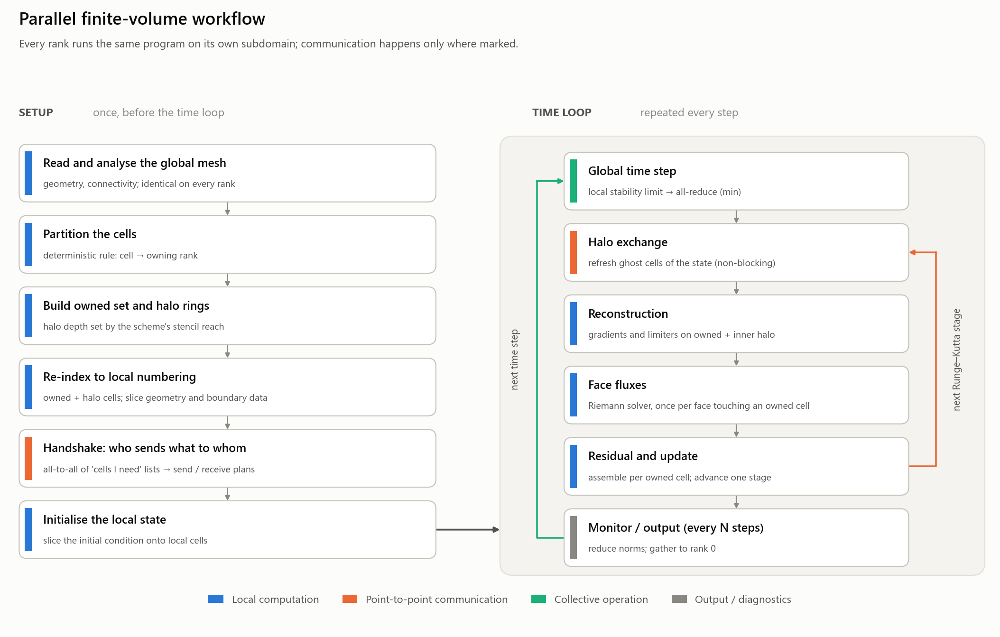
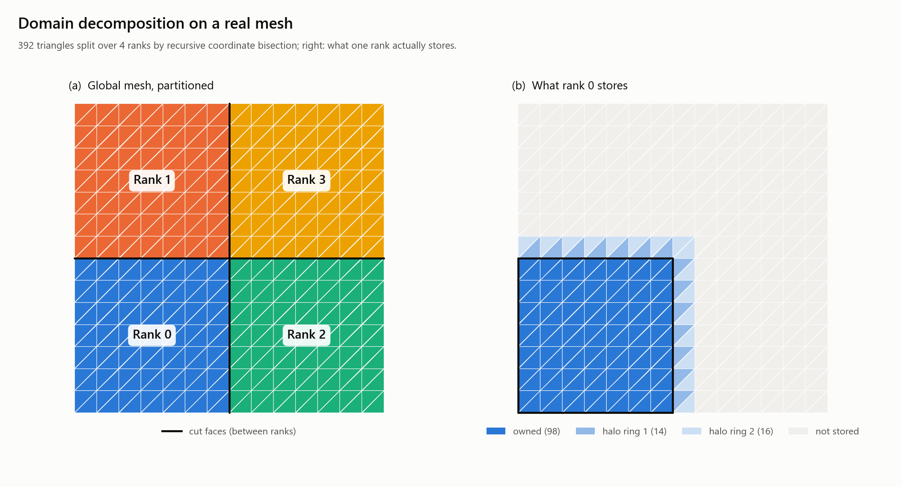
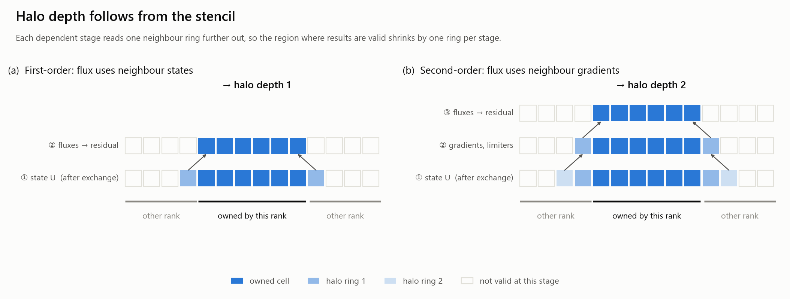
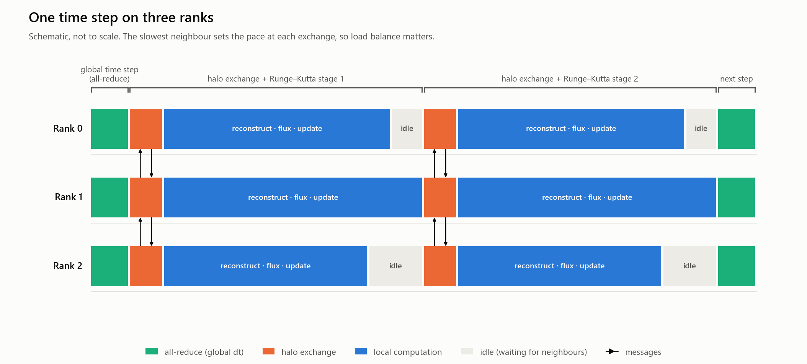
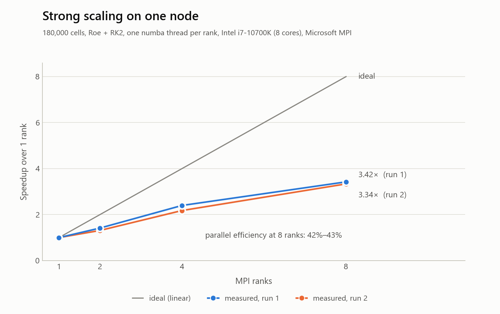

# Parallel finite-volume methods with MPI: a workflow guide

A practical guide to running a finite-volume (FVM) simulation on many MPI ranks
by **domain decomposition**: what to build once, what to do every step, why it
is correct, and how to reuse the pattern for other FVM codes. The first ten
sections are method-level and independent of this repository; section 11 maps
each concept to the code here and shows a worked example with real data.

> Companion to [ARCHITECTURE.md](ARCHITECTURE.md) (module map, numerics).
> Figures are generated by `python utility/figures/make_parallel_figures.py`.

**Contents**
[1 Idea](#1-the-idea) ·
[2 Workflow](#2-the-workflow) ·
[3 Partitioning](#3-partitioning-the-mesh) ·
[4 Halo design](#4-halo-design) ·
[5 Local data and the handshake](#5-local-data-structures-and-the-handshake) ·
[6 Time loop](#6-the-time-loop) ·
[7 Correctness](#7-correctness-and-verification) ·
[8 Performance](#8-performance) ·
[9 Principles](#9-design-principles) ·
[10 Pitfalls](#10-pitfalls) ·
[11 Adapting](#11-adapting-the-pattern) ·
[12 This repository](#12-implementation-map-for-this-repository) ·
[13 Glossary](#13-glossary)

---

## 1. The idea

A finite-volume scheme advances each cell by the net flux through its faces:

```
d(V_i U_i)/dt  =  - Σ_faces F_f · A_f  +  V_i S_i
```

Every term is **local**: the flux on a face depends on the states of the cells
around it (and, for higher-order schemes, on a small reconstruction stencil).
That locality is what makes FVM parallelise well. Cut the mesh into parts, give
each part to a process, and each process needs only a thin layer of data from
its neighbours.

**SPMD.** `mpiexec -n P python examples/euler_riemann/main.py` starts P copies of the *same* program
(ranks), each with private memory. They share nothing unless one sends a message.

**Owned and ghost cells.** A rank *owns* one part and advances only those
cells. Cells of neighbouring parts that its stencil reads are stored as
read-only **ghost** (halo) copies.

```
 global mesh      [ a a a a | b b b b ]

 rank A stores    [ a a a a | b b ]        owned: a      ghost copies: b
 rank B stores    [ a a | b b b b ]        owned: b      ghost copies: a
```

The entire parallel method reduces to two jobs:

1. **Once:** decide who owns what, and who must send what to whom.
2. **Every step:** refresh the ghost copies from their owners, then compute
   locally exactly as the serial code would.

---

## 2. The workflow



*Figure 1. Blue = local computation, orange = point-to-point communication,
green = collective operation, grey = output. Only the orange and green steps
involve MPI; everything blue is the unchanged serial numerics.*

| Stage | Purpose | Communication |
| --- | --- | --- |
| Read / analyse mesh | geometry and connectivity, identical on all ranks | none |
| Partition | assign every cell to a rank | none (deterministic) |
| Owned set + halo rings | decide which extra cells each rank must store | none |
| Local numbering | owned + halo cells; slice geometry, boundary data | none |
| Handshake | each rank tells owners which cells it needs | one all-to-all |
| Global time step | all ranks must advance by the same `dt` | all-reduce (min) |
| Halo exchange | make ghost values current | point-to-point, neighbours only |
| Reconstruction | gradients, limiters, higher-order face states | none |
| Face fluxes | Riemann solver or flux function | none |
| Residual + update | assemble and advance owned cells | none |
| Monitor / output | norms, conservation checks, snapshots | reduce / gather |

---

## 3. Partitioning the mesh



*Figure 2. A real mesh from this repository, partitioned by recursive
coordinate bisection. Panel (b) is exactly what one rank holds in memory.*

A good partition has three properties:

| Goal | Why | Typical tool |
| --- | --- | --- |
| **Balanced work** | the slowest rank sets the step time | equal cell counts, or weights (cost per cell) |
| **Small cut** | halo size, hence communication volume, grows with the cut | graph / geometric partitioners |
| **Deterministic** | every rank can compute the same map with no communication | seeded, order-independent algorithms |

| Method | Notes |
| --- | --- |
| Recursive coordinate bisection (RCB) | simple, geometric, deterministic; used here |
| Space-filling curve (Hilbert / Morton) | very cheap, good locality, handy for AMR |
| Graph partitioning (METIS, ParMETIS, Scotch) | smallest cut on irregular meshes; standard for production |
| Weighted / dynamic re-partitioning | needed when cost per cell varies or the mesh adapts |

In 2D the communication per rank scales with the subdomain *perimeter*
(~√(N/P) cells) while compute scales with its *area* (N/P), so the
communication-to-computation ratio worsens as you add ranks to a fixed problem.

---

## 4. Halo design

### 4.1 Rings

*Ring k* is the set of cells exactly k adjacency hops outside the owned region.
Which adjacency to use follows the stencil: face-neighbours for cell-centred
schemes, node-sharing neighbours when the scheme gathers over vertices.

### 4.2 How deep must the halo be?



*Figure 3. Results are valid only where all their inputs were valid. Each
dependent stage that reads neighbours shrinks the valid region by one ring.*

> **Rule.** Halo depth = number of neighbour hops one residual evaluation reads
> *between two exchanges*, summed over its dependent stages.

| Scheme | Dependent stages | Halo depth (one exchange per evaluation) |
| --- | --- | --- |
| First-order upwind / Rusanov | flux ← neighbour state | 1 |
| MUSCL, gradients from face neighbours (LSQ, Green-Gauss) | flux ← neighbour gradient ← its neighbours' states | 2 |
| Same, but exchange gradients too | state exchange, then gradient exchange | 1 ring, **two** exchanges |
| Gradient from node-sharing neighbours | wider stencil in hops | 2 or more; check the connectivity |
| Viscous flux with face gradients from cell gradients | as MUSCL | 2 |
| WENO5 (6-cell face stencil) | face stencil reaches 3 cells beyond the owned cell | 3 |
| Multi-stage Runge-Kutta | each stage needs fresh halos | exchange every stage (or depth × stages with redundant work) |
| Implicit solver (matrix-free Krylov) | one matvec = one hop | 1 exchange per iteration, plus all-reduces for dot products |

Deeper halos trade **more redundant computation and memory** for **fewer
messages**. For explicit schemes with moderate subdomain sizes, "depth =
stencil radius, one exchange per stage" is the usual sweet spot.

---

## 5. Local data structures and the handshake

**Local numbering.** Each rank stores `owned ∪ halo` cells in one local array
and keeps `global_ids[local]` and the inverse map. Geometry, connectivity,
boundary data, and the initial state are *sliced* onto this local set, so the
numerical kernels see an ordinary small mesh. Neighbours not stored locally are
marked missing (they only occur on the outermost ring and are never trusted).

**Boundaries.** Faces on the partition cut are *interior* faces of the global
mesh, not boundary conditions. Physical boundary data are sliced with the cells;
the outer halo ring's missing neighbours need a harmless placeholder because
their results are discarded.

**Ordering.** Keep local cells in ascending *global* id. This single choice
makes face ownership and summation order identical to the serial run (section 7).

**The handshake.** A rank knows which halo cells it needs but not what the
others need from it. One collective closes the loop:

```
wanted[q]    = global ids I need that rank q owns        (sorted)
requested    = all-to-all(wanted)                          # requested[q] = ids q needs from me
recv[q]      = local rows of my ghost copies owned by q
send[q]      = local rows of my owned cells listed in requested[q]
```

Both lists are sorted by global id, so a receive buffer needs no metadata:
element *k* from the sender is row *k* of the receiver's list.

**Cut faces and conservation.** Two ranks see each cut face. Choose one rule:

| Strategy | How | Trade-off |
| --- | --- | --- |
| **A. Both compute the same flux** (used here) | deterministic owner of the face; each side evaluates it from identical data | a little redundant work; no flux message; bitwise reproducible |
| B. One side computes, sends the flux | exact conservation by construction | extra message each stage |
| C. Each side computes independently | simplest | conservation holds only to round-off |

---

## 6. The time loop



*Figure 4. Schematic. At each exchange a rank waits for its neighbours, so
the slowest rank paces the step: this is why load balance matters.*

### 6.1 Communication patterns

| Pattern | When | MPI operations | Size / cost |
| --- | --- | --- | --- |
| **Halo exchange** | before every residual evaluation | `Irecv` + `Isend` to each neighbour, `Waitall` | KBs, neighbours only |
| **Global reduction** | once per step: `dt` (min); monitors: residual norm (sum/max), conserved totals (sum) | `Allreduce` | tiny, ~log P latency |
| **Gather / parallel I/O** | only on output steps | `Gather` to rank 0, or MPI-IO | O(N): the expensive one |

Use **non-blocking** `Isend`/`Irecv` + `Waitall`: every rank both sends and
receives, so naive blocking sends can deadlock.

### 6.2 What is valid when

```
                    owned cells     ghost cells
after exchange      valid           valid  (copy of the owner's value)
after the update    valid (new)     STALE  (not updated by this rank)
next evaluation     an exchange makes the ghosts valid again before they are read
```

So every residual evaluation starts with an exchange, and everything that must
not depend on stale data uses **owned entities only**: the time-step reduction,
monitors, and output.

### 6.3 Variants

| Method | What changes |
| --- | --- |
| Multi-stage RK | one exchange per stage |
| Local time stepping / steady state | no global `dt`; residual norm all-reduce for convergence |
| Implicit (Newton-Krylov) | halo exchange in each matvec; `Allreduce(sum)` for dot products; distributed preconditioner |
| Adaptive mesh refinement | re-partition and rebuild halos after adapting |
| Overlap | compute the interior while halo messages are in flight (not implemented here) |

---

## 7. Correctness and verification

Three properties make the distributed result **bitwise identical** to the
serial one in this code (max difference exactly `0.0` on 2, 3, 4 and 6 ranks):

1. **Same data in every stencil**: enough halo rings and an exchange before
   each evaluation mean every owned cell sees exactly the serial values.
2. **Same evaluation order**: ascending global ids give the same face owners and
   the same summation order per cell; both ranks evaluate a cut face from the
   same side.
3. **Order-independent reductions**: a minimum of floats is the same in any
   order, so every rank derives the same `dt`.

If your algorithm sums across ranks (`Allreduce(sum)`), expect round-off-level
differences and compare with a tolerance.

**A test ladder worth copying**

| Level | Check |
| --- | --- |
| Partition | every cell owned exactly once; parts balanced |
| Halo plan | `send` of rank *a* to *b* mirrors `recv` of *b* from *a* (same ids, same order) |
| Equivalence | distributed == serial for several rank counts, fluxes, integrators |
| Conservation | totals change only through physical boundaries |
| **Mutation** | deliberately disable the exchange: the tests must fail (here: error 1.04) |
| Fake ranks | a thread-based communicator tests the logic without an MPI runtime |

---

## 8. Performance

### 8.1 A simple model

```
T_step(P) ≈ T_compute(N/P)  +  T_halo( perimeter ~ √(N/P) )  +  T_reduce( ~ log P )  +  T_wait( imbalance )
```

Compute dominates for large subdomains; halo and latency terms take over as
subdomains shrink; imbalance adds directly to the critical path.

### 8.2 Measured strong scaling



*Figure 5. 180,000 triangles, Roe flux + RK2, one numba thread per rank, Intel
i7-10700K (8 cores / 16 threads), Microsoft MPI 10.1, mpi4py 4.1, idle machine.*

| Ranks | ms/step (run 1 / run 2) | Speedup | Efficiency |
| --- | --- | --- | --- |
| 1 | 100.0 / 90.7 | 1.00 / 1.00 | 100% / 100% |
| 2 | 70.8 / 69.2 | 1.41 / 1.31 | 71% / 66% |
| 4 | 41.7 / 41.7 | 2.40 / 2.18 | 60% / 54% |
| 8 | 29.2 / 27.2 | 3.42 / 3.34 | 43% / 42% |

### 8.3 How to interpret numbers like these

1. **Separate the costs**: time compute, exchange, reductions and setup
   independently. Here exchange latency is 8-34 µs and setup is excluded: compute
   dominates.
2. **Run the no-communication control**: every rank solves the *same* full
   problem independently. It slowed from 44 ms (1-2 ranks) to 53 ms (4) and
   107-112 ms (8): the machine itself cannot run 8 such jobs side by side, so the
   ceiling is **shared memory bandwidth / cache**, not MPI.
3. **Watch the working set**: at 20k cells (cache-resident) the residual scaled
   almost ideally (6.4 / 3.3 / 1.75 ms on 1 / 2 / 4 ranks); at 180k cells (~60 MB
   of geometry vs a 16 MB L3) it is bandwidth-bound.
4. **Multi-node runs add memory bandwidth**, so expect better efficiency there.

### 8.4 Levers when scaling stalls

| Lever | Effect |
| --- | --- |
| Reduce bytes per cell (single precision geometry, fuse kernels) | helps bandwidth-bound runs |
| Overlap communication with interior computation | hides latency when compute per step is small |
| Better partitioner / weights | smaller cut, better balance |
| Hybrid MPI + threads (few ranks per node, threads inside) | fewer, larger subdomains; avoids oversubscription |
| Gather rarely (`save_every`), use parallel I/O | removes an O(N) serial step |

---

## 9. Design principles

1. **Keep MPI out of the numerical kernels.** Serial and parallel run the same
   residual code; MPI lives in a thin layer around it.
2. **Hide MPI behind a tiny interface** (reduce, all-to-all, halo exchange,
   gather). A no-op serial version and a thread-based fake make the whole
   distributed logic testable without an MPI runtime.
3. **Set up once.** Partition, halo plan, local arrays and boundary data are
   built before the loop; the loop only moves arrays.
4. **Derive halo depth from the stencil**, not by guesswork.
5. **Skip useless work**: no gradients on the outermost ring, no faces away from
   owned cells.
6. **Make parallel == serial testable**: deterministic ordering turns correctness
   into one comparison.
7. **Gather rarely**; treat global output as expensive.
8. **Preallocate and reuse** message buffers and scratch arrays.

---

## 10. Pitfalls

| Pitfall | What happened | Lesson |
| --- | --- | --- |
| Aliased scratch buffer | A boundary routine returned the array it was given; the kernel rebound the "right state" to it and later faces overwrote the "left state". Results silently changed. | Copy into a preallocated buffer; never rebind a reused scratch array to something that may alias another. A regression run against known-good output caught it. |
| Benchmark gathered the whole field each step | `save_every=1` pickled the global state every step; scaling looked terrible. | Measure the solver, not the I/O. |
| Setup inside the timed region | Every rank repeats O(N) setup; its noise swamped a short loop. | Report setup and loop time separately. |
| Foreign load on the machine | Another 4-process MPI job at 100% CPU invalidated timings. | Check CPU load and running processes before benchmarking; never kill processes you did not start. |
| Thread oversubscription | ranks × threads > cores | One thread per rank when running many ranks per node. |
| Compiled threads + fake ranks | thread-based "ranks" call parallel numba regions concurrently | Run those tests with JIT disabled or one thread. |
| Blaming MPI for slow scaling | 8 ranks gave only 3.4× | Run the no-communication control first. |
| Tests that cannot fail | An equality test is only useful if breaking the exchange breaks it | Add a mutation check. |

---

## 11. Adapting the pattern

### 11.1 Checklist

| # | Question | Answer in this project |
| --- | --- | --- |
| 1 | What does one residual evaluation read, in cell hops? | 2 (neighbour gradient ← neighbours' states) |
| 2 | So how many halo rings per exchange? | 2 |
| 3 | How is the mesh partitioned, deterministically? | RCB on centroids |
| 4 | Local ordering, and does it match the serial order? | ascending global id: yes |
| 5 | What must be exchanged each step? | the conserved state |
| 6 | Which quantities need a global reduction? | stable `dt` (min) |
| 7 | Which results are valid only on owned entities? | residual, `dt`, output |
| 8 | What is the cut-face rule (A, B or C)? | A: identical deterministic flux on both sides |
| 9 | How do I verify parallel == serial, and can the test fail? | exact comparison; mutation check |

### 11.2 Other FVM settings

| Setting | What changes |
| --- | --- |
| Vertex-centred (dual-mesh) FVM | halo defined by shared nodes / dual cells; exchange node data |
| 3D, mixed element types | same pattern; larger halos per face count |
| Source terms, multiphysics | more variables per cell in each exchange; couple through the same halos |
| Moving / deforming mesh | exchange mesh velocities or coordinates; rebuild geometry per step |
| AMR / dynamic load balance | re-partition and rebuild plans after adaptation; migrate cell data |
| Implicit / steady-state | halo exchange in each matvec; all-reduces in the Krylov solver |
| Structured grids | blocks instead of graph parts; halos are slabs (Cartesian communicators) |
| Particle-in-cell, SPH | halo = copied boundary particles; migration of particles that cross cuts |

### 11.3 Generic skeleton

```python
comm = get_comm()                         # serial no-op or MPI
part = partition(mesh, comm.size)         # deterministic, identical on every rank
dom  = build_domain(mesh, part, comm)     # owned/halo sets, local arrays, send/recv plans
U    = U_initial[dom.global_ids]

for step in range(nsteps):
    dt = comm.allreduce_min(stable_dt(U[dom.owned]))
    for stage in rk_stages:
        dom.exchange(U)                   # ghosts current
        R = residual(U)                   # unchanged serial numerics
        U = advance(U, R, dt, stage)      # ghost rows are stale afterwards
    if output_due(step):
        snapshot = dom.gather(U)          # rank 0 only
```

---

## 12. Implementation map for this repository

| Concept | Where |
| --- | --- |
| Communicator interface, serial no-op, MPI wrapper | [src/parallel.py](src/parallel.py): `Communicator`, `SerialComm`, `MPIComm` |
| Partitioner | [src/partition.py](src/partition.py): `partition_rcb` |
| Halo rings, local arrays, handshake, send/recv plans | [src/partition.py](src/partition.py): `build_domain`, `Domain` |
| Halo exchange, gather | `Domain.exchange`, `Domain.gather`; `MPIComm.exchange` (`Isend`/`Irecv`/`Waitall`) |
| Time loop, global `dt`, residual wrapper | [src/solver.py](src/solver.py): `solve` |
| Serial numerics (unchanged by MPI) | [src/residual.py](src/residual.py), [src/reconstruction.py](src/reconstruction.py), [src/time_step.py](src/time_step.py) |
| Fake ranks for tests | `ThreadComm` inside [tests/integration/test_distributed_threads.py](tests/integration/test_distributed_threads.py) |
| Parallel tests | [tests/integration/test_distributed_threads.py](tests/integration/test_distributed_threads.py) (thread ranks), [utility/checks/mpi_parity_check.py](utility/checks/mpi_parity_check.py) + [tests/integration/test_mpi_real.py](tests/integration/test_mpi_real.py) (real MPI) |
| Scaling benchmark | [utility/benchmarks/bench_scaling.py](utility/benchmarks/bench_scaling.py) |
| Figures | [utility/figures/make_parallel_figures.py](utility/figures/make_parallel_figures.py) |

### 12.1 Worked example (real output)

`Mesh.unit_square(4)`: 4×4 squares of 2 triangles = 32 cells on 2 ranks.
Square (i, j) holds cells `8j+2i` and `8j+2i+1`.

```
   y
   ▲   i=0      i=1      i=2      i=3
 j=3   24,25    26,27    28,29    30,31
 j=2   16,17    18,19    20,21    22,23
 j=1    8, 9    10,11    12,13    14,15
 j=0    0, 1     2, 3     4, 5     6, 7
       └──── rank 0 owns ───┘└──── rank 1 owns ───┘
```

| | Rank 0 | Rank 1 |
| --- | --- | --- |
| Owned (global ids) | 0-3, 8-11, 16-19, 24-27 | 4-7, 12-15, 20-23, 28-31 |
| Ring-1 ghosts | 5, 13, 21, 29 | 2, 10, 18, 26 |
| Ring-2 ghosts | 4, 12, 20, 28 | 3, 11, 19, 27 |
| Local cells | 24 (16 owned + 8 ghost) | 24 (16 owned + 8 ghost) |
| Gradients computed on | owned + ring 1 = 20 cells | owned + ring 1 = 20 cells |
| Unique faces computed | 30 of 56 | 30 of 56 |

```
 rank 0                                          rank 1
 ─────────────────────────────────────────       ─────────────────────────────────────────
 RECV from rank 1: global [4,5,12,13,20,21,28,29]   RECV from rank 0: global [2,3,10,11,18,19,26,27]
 SEND to   rank 1: global [2,3,10,11,18,19,26,27]   SEND to   rank 0: global [4,5,12,13,20,21,28,29]
```

What rank 0 **sends** is exactly what rank 1 **receives**, in the same order
(each exchange: 8 cells × 4 variables × 8 bytes = 256 B per direction).
`30 + 30 = 60 > 56`: the 4 cut faces are computed by both ranks (strategy A).

### 12.2 Running

```bash
pip install -r requirements-mpi.txt              # mpi4py; needs an MPI runtime (MS-MPI, OpenMPI, ...)

NUMBA_NUM_THREADS=1 mpiexec -n 4 python examples/euler_riemann/main.py   # run the solver
NUMBA_NUM_THREADS=1 mpiexec -n 4 python utility/checks/mpi_parity_check.py   # distributed == serial
NUMBA_NUM_THREADS=1 mpiexec -n 8 python utility/benchmarks/bench_scaling.py --n 300 --steps 40
python -m pytest tests                                          # fake ranks; real-MPI test skips if unavailable
python utility/figures/make_parallel_figures.py                 # regenerate doc/figures
```

Experiments that teach the most: print `dom.send` / `dom.recv` per rank for
different rank counts; make the halo one ring thick and watch the parity test
fail; comment out the exchange in `solve()` and watch parity break; compare
`save_every=1` against a large value in the benchmark.

### 12.3 Known limits of this implementation

Every rank builds the *global* mesh during setup (O(N) memory per rank); the
partitioner is geometric (RCB), not graph-based; no communication/computation
overlap; output is gathered to rank 0; the shallow-water fluxes are not yet
allocation-free.

---

## 13. Glossary

| Term | Meaning |
| --- | --- |
| **Rank** | One MPI process; `0 … size-1`. |
| **SPMD** | Single Program, Multiple Data: every rank runs the same code. |
| **Owned cell** | A cell this rank advances and is responsible for. |
| **Ghost / halo cell** | Read-only local copy of a cell owned by another rank. |
| **Ring k** | Cells k adjacency hops outside the owned region. |
| **Halo exchange** | Refreshing ghost values from their owners (point-to-point). |
| **Cut face** | A face between cells owned by different ranks. |
| **Collective** | An operation all ranks join (`Allreduce`, `Alltoall`, `Gather`). |
| **Handshake** | The one-time all-to-all that builds the send / receive plans. |
| **Strong scaling** | Fixed problem size, more ranks; efficiency = speedup / ranks. |
| **Control run** | Same work per rank, no communication: isolates hardware limits. |
